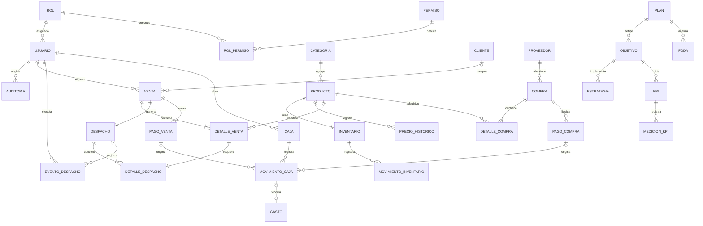
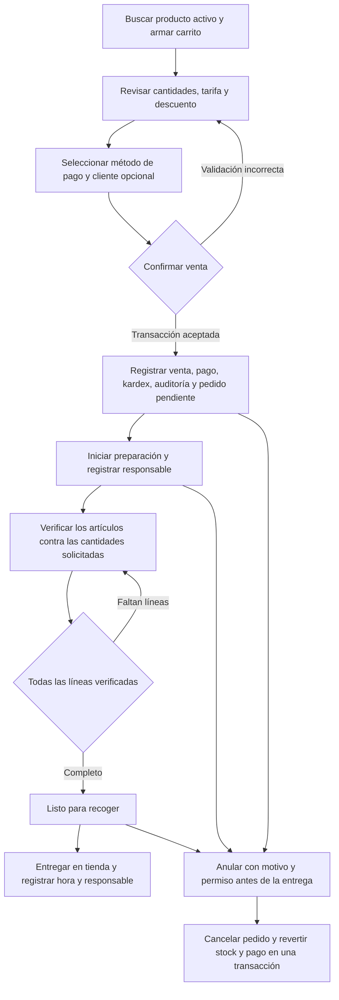

# Arquitectura de Comercium

## 1. Capas y responsabilidades

WPF presenta la operación en español mediante vistas y ViewModels. Los ViewModels traducen acciones de la interfaz a casos de uso. La capa de aplicación define sus contratos, permisos y validaciones de entrada. El dominio contiene el modelo comercial y las transiciones válidas. Infraestructura usa EF Core y SQLite para consultas, migraciones y transacciones, y proporciona los adaptadores de seguridad, respaldo y exportación. La composición de dependencias vive en la aplicación WPF.

SQLite se aloja en el perfil local de Windows. La distribución inicial contempla una computadora de tienda y varias cuentas de Comercium dentro del mismo perfil de Windows. Se admiten consultas y operaciones comerciales sin conexión. Las operaciones registran el usuario de Comercium y la fecha UTC. La interfaz convierte las fechas al horario local de la tienda.

## 2. Estructura

```text
Comercium.slnx
src/
  Comercium.App/             Vistas WPF, ViewModels, recursos, inicio
  Comercium.Domain/          Entidades, estados, reglas de dominio
  Comercium.Application/     Contratos y casos de uso
  Comercium.Infrastructure/  SQLite, migraciones, seguridad y adaptadores
tests/
  Comercium.Tests/           Pruebas con bases SQLite temporales
docs/                        Arquitectura y manuales
```

## 3. Modelo relacional objetivo



`Configuración` conserva los parámetros del negocio. Las tablas transaccionales tienen claves primarias y foráneas con eliminación restrictiva. Se indexan el código normalizado del producto, el nombre normalizado del usuario, las fechas de operación, el estado de despacho y la identidad de las operaciones que cambian existencias. Cada venta conserva el precio y costo aplicados. El kardex registra el saldo resultante de cada movimiento.

## 4. Venta y despacho en tienda



Confirmar una venta obtiene los precios vigentes y comprueba el saldo dentro de la transacción. Un identificador único evita repetir una venta ante reintentos. Una anulación conserva la operación y agrega contramovimientos. Entregar un pedido exige el estado listo y una segunda comprobación de las líneas verificadas. La lista impresa incluye cantidades y ubicación en tienda. El comprobante es de uso interno.

## 5. Diseño del tablero

```text
╭─────────────────┬─────────────────────────────────────────────────────╮
│ COMERCIUM       │ Resumen de la tienda             [ Nueva venta ]    │
│                 │                                                     │
│ Inicio          │ [ Ventas hoy ] [ Ventas del mes ] [ Margen del mes ] │
│ Ventas          │ [ Productos  ] [ Stock bajo     ] [ Agotados       ] │
│ Despacho        │                                                     │
│ Productos       │ [ Evolución de ventas, últimos 7 días             ] │
│ Inventario      │                                                     │
│ Compras         │ [ Pedidos por preparar ] [ Productos más vendidos ] │
│ Clientes        │ [ Compras recientes   ]                              │
│ Caja y finanzas │                                                     │
│ Reportes        │                                                     │
│ Análisis        │                                                     │
│ Planificación   │                                                     │
│ Cuenta          │                                                     │
╰─────────────────┴─────────────────────────────────────────────────────╯
```

Menú azul marino, superficies blancas, acento celeste y tipografía Segoe UI. Las acciones tienen etiquetas explícitas. Formularios cortos, tablas seleccionables y confirmaciones para acciones irreversibles. En resoluciones pequeñas, el área de trabajo permite desplazamiento. Los indicadores y listas se calculan desde operaciones persistidas, con estados vacíos comprensibles.

## 6. Entregas y criterios de aceptación

| Etapa | Entrega | Comprobación |
| --- | --- | --- |
| 1 | Requisitos y arquitectura | Revisar relaciones, estados y criterios de integridad. |
| 2 | Solución y dependencias | Restaurar paquetes y compilar los proyectos. |
| 3 | Persistencia y migraciones | Aplicar las migraciones sobre SQLite vacío y reabrirlo. |
| 4 | Cuenta, acceso y tablero | Crear propietaria, iniciar y cerrar sesión, cambiar clave y consultar datos persistidos. |
| 5 | Catálogo e inventario | Editar producto, mantener precios previos y conciliar saldo con el kardex. |
| 6 | Ventas | Cobrar con stock real y evitar dobles descuentos. |
| 7 | Despacho | Verificar línea a línea, preparar, imprimir y entregar en tienda. |
| 8 | Compras y proveedores | Ingresar existencias y consultar obligaciones y costos por proveedor. |
| 9 | Clientes y finanzas | Consultar compras por cliente y conciliar una sesión de caja. |
| 10 | Reportes | Validar filtros y exportar los mismos resultados a PDF y Excel. |
| 11 | Análisis y consultas | Comparar períodos, calcular rotación y contestar preguntas con los datos locales. |
| 12 | Planificación | Editar el plan, guardar FODA y registrar avances con KPI. |
| 13 | Cierre | Verificar escenarios, respaldo y restauración, distribución Windows y manuales. |

## 7. Dependencias

- SDK .NET 10 LTS con WPF y `net10.0-windows10.0.19041.0` para seleccionar las dependencias modernas del control gráfico. Microsoft limita el soporte de Windows 10 a las ediciones y versiones indicadas en su matriz. [Versiones de Windows admitidas](https://learn.microsoft.com/en-us/dotnet/core/install/windows#supported-versions)
- `Microsoft.EntityFrameworkCore.Sqlite` 10.0.12 y herramientas de migración de la misma versión. [Proveedor SQLite](https://learn.microsoft.com/en-us/ef/core/providers/sqlite/)
- `LiveChartsCore.SkiaSharpView.WPF` 2.0.5 para el tablero. [Paquete WPF](https://www.nuget.org/packages/LiveChartsCore.SkiaSharpView.WPF/2.0.5)
- `PDFsharp-MigraDoc-WPF` 6.2.4 para PDF y `ClosedXML` 0.105.0 para Excel. [MigraDoc para WPF](https://www.nuget.org/packages/PDFsharp-MigraDoc-WPF/6.2.4), [ClosedXML](https://www.nuget.org/packages/ClosedXML/0.105.0)
- `Rfc2898DeriveBytes.Pbkdf2` de .NET para credenciales y xUnit para las pruebas. La distribución autónoma de .NET incluye el runtime de escritorio.

## 8. Decisiones de integridad y preguntas pendientes

| Tema | Decisión inicial o confirmación pendiente |
| --- | --- |
| Moneda y cantidades | Usar soles y céntimos enteros. La primera operación trabaja con unidades enteras de la presentación registrada. Confirmar si hay venta fraccionada. |
| Costo y utilidad | Guardar costo al momento de venta. El costo vigente corresponde a la última recepción o al valor actualizado desde el catálogo. Mostrar margen bruto como venta neta menos costo, y utilidad operativa después de gastos en finanzas. Confirmar si el negocio requiere costo promedio ponderado u otra política de valoración. |
| Descuentos | Controlar el permiso en el caso de uso. Confirmar topes, montos y porcentajes por rol antes de habilitar otras cuentas. |
| Anulación | Permitir anular antes de la entrega con motivo. Una devolución posterior requiere definir reintegro, estado del producto y caja de devolución. |
| Despacho | Preparación y entrega se registran como eventos distintos. La cancelación comercial libera existencias mediante la anulación de venta. |
| Caja | El saldo esperado parte del importe de apertura y agrega movimientos en efectivo. La caja abierta es opcional. Si se asentó un cobro en efectivo, el reintegro requiere una sesión abierta. La venta y el movimiento automático se guardan en la misma transacción. |
| Comprobante | Emitir comprobante interno. La facturación tributaria requiere un alcance adicional. |
| Copias de seguridad | Usar la API de respaldo SQLite y verificar integridad antes de restaurar. Las fotos se guardan dentro de la base para conservarlas junto con el respaldo. Una copia previa permite recuperar la base reemplazada. |
| Usuarios | La propietaria se crea en la primera ejecución. Confirmar perfiles de cajero y encargado de despacho cuando se incorporen otras personas. |
